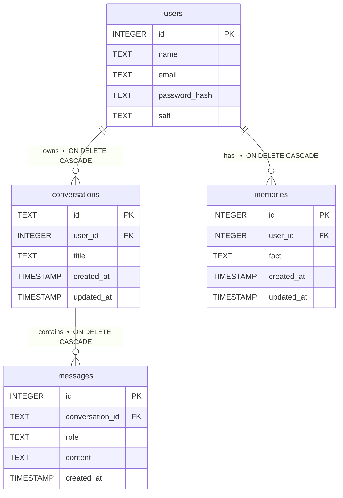

<div align="center">


# A.L.I.A.S.
### Advanced Logical Interface and Assistant System

*A powerful, voice-activated AI desktop assistant with persistent memory and multi-model intelligence.*

[](https://python.org)
[](https://react.dev)
[](https://electronjs.org)
[](https://fastapi.tiangolo.com)
[](https://sqlite.org)
[](LICENSE)

</div>

---

## 📖 Overview

**ALIAS** is a feature-rich AI desktop assistant that runs natively on Windows as an Electron app. Unlike cloud-only assistants, ALIAS runs a local Python backend that gives it real system access — it can open apps, control media, manage files, read your active window, and even generate AI images.

With **persistent chat history** and an **intelligent long-term memory system**, ALIAS behaves like a true personal AI — it learns who you are across sessions and uses that context to personalize every response. You can chat with it over text or voice, switch between multiple state-of-the-art AI models on the fly, and have it remember important facts about you forever.

---

## ✨ Features

### 🧠 Intelligence & Memory
| Feature | Description |
|---|---|
| **Persistent Chat History** | Every conversation is saved to a local SQLite database. Sessions survive restarts. |
| **ChatGPT-style Sidebar** | Browse, open, rename, and delete past chats from a sleek history panel. |
| **Keyword History Search** | Filter past conversations in real time from the sidebar search bar. |
| **Long-Term Memory Extraction** | ALIAS automatically extracts personal facts (name, skills, projects, goals) from your conversations using Gemini and stores them. |
| **Proactive Context Injection** | Before every response, ALIAS loads your memories and relevant past chat excerpts and prepends them to the LLM system prompt. |
| **Memory Management Dashboard** | View and delete individual memories at any time from the **Memory** tab in Settings. |
| **Natural Memory Commands** | Tell ALIAS to remember, forget, or update facts in plain English. |

### 🤖 AI & Models
| Feature | Description |
|---|---|
| **Multi-Model Support** | Switch between Gemini, GPT-4o, DeepSeek, Groq Llama, and Qubrid GPT-OSS live from the sidebar. |
| **Creativity Slider** | Real-time temperature control (0.0 – 1.0) for precise vs. creative responses. |
| **Markdown Rendering** | AI output is rendered with full GFM markdown — tables, code blocks, bold, lists. |
| **Syntax Highlighting** | Code responses use VS Code dark theme highlighting with one-click copy. |
| **Mermaid Diagrams** | Ask for architecture diagrams and ALIAS renders them inline. |
| **Strict Formatting Mode** | Enforced "no asterisk" policy and dash-only bullet points for cleaner tech output. |

### 🎭 Avatars & Floating Companion
| Feature | Description |
|---|---|
| **Interactive Avatars** | Multiple character models (Onee, GrokBot, Alien, Strobi) with dynamic moods and animations. |
| **Speech Reactivity & Lip Sync** | Avatars react to speech synthesis in real time with synchronized mouth expressions. |
| **Floating Companion Widget** | Draggable, floating desktop companion with interactive clicks, sound effects, and quick actions. |
| **Avatar Studio** | Customize avatar styles, colors, accessories, voices, and personality traits. |

### 🔐 Authentication & User Profiles
| Feature | Description |
|---|---|
| **Multi-Provider Auth** | Sign in with Google (Firebase Popup / OAuth), Email & Password, or run offline in Guest Mode. |
| **Flexible Firebase Config** | Configure Firebase credentials dynamically via Settings or `.env` without modifying code. |
| **Per-User Memory Isolation** | Chat history, extracted memories, and settings are strictly scoped per authenticated user. |

### 🎨 Image Generation Studio
| Feature | Description |
|---|---|
| **Multi-Provider Generation** | Generate images using Pollinations.ai, AI Horde, or local backends. |
| **Natural Language Prompts** | Trigger image generation via chat: *"Generate an image of a futuristic cyberpunk city."* |
| **Aspect Ratios & Controls** | Choose from Square (1:1), Landscape (16:9), Portrait (9:16), Story (4:5), or Wide (21:9) with custom dimensions and seeds. |
| **Image History Gallery** | View, inspect generation metadata, copy prompts, and download previous creations. |

### 📄 Document Operations Suite
| Feature | Description |
|---|---|
| **Document Processing & Export** | Read, manipulate, and generate PDF (`.pdf`) and Word (`.docx`) files. |
| **Report Generation** | Automated report and document creation powered by ReportLab and python-docx. |

### 🖥️ Desktop Control
| Feature | Description |
|---|---|
| **App Launcher** | Open any application: *"Open Chrome"*, *"Open Calculator"*. |
| **Media Control** | Play, pause, skip tracks system-wide. |
| **File Search & Open** | Search for files by name and auto-open them. |
| **Window Awareness** | ALIAS reads your active window title to provide context-aware answers. |
| **Email Sending** | Send emails directly via Gmail using a simple voice command. |

### 🎤 Voice & Speech
| Feature | Description |
|---|---|
| **Speech-to-Text** | System microphone STT via Python backend. |
| **Text-to-Speech** | High-quality Edge TTS neural voices (online). |
| **Voice Selection** | Switch between Christopher (Male) and Nova (Female) from Settings. |
| **Stop Speaking** | Immediately silence ALIAS mid-speech with the Stop button. |

### ⚙️ Settings & Dynamic Keys
| Feature | Description |
|---|---|
| **In-App API Key Manager** | Enter and update Gemini, OpenAI, Groq, DeepSeek, and Pollinations keys directly from the UI. |
| **Firebase Credential Setup** | Interactive Firebase configuration validator and manager within Settings. |
| **Dark / Light / System Theme** | Full theme switching with Tailwind CSS dark mode and glassmorphism styling. |
| **Real-time WebSocket Sync** | Instant UI updates via Socket.IO WebSocket events. |

---

## 🏗️ Architecture

```
┌─────────────────────────────────────────────────────────────────────┐
│                         Electron Desktop App                         │
│  ┌──────────────────────────────────────────────────────────────┐   │
│  │                     React Frontend (Vite)                     │   │
│  │  ┌─────────────┐  ┌──────────────────┐  ┌────────────────┐  │   │
│  │  │  Sidebar    │  │   Chat Window     │  │  Settings      │  │   │
│  │  │  - History  │  │   - Messages      │  │  - Theme       │  │   │
│  │  │  - Search   │  │   - Markdown      │  │  - Voice       │  │   │
│  │  │  - Rename   │  │   - Code Blocks   │  │  - Memory      │  │   │
│  │  │  - Delete   │  │   - Image Preview │  │    Dashboard   │  │   │
│  │  └─────────────┘  └──────────────────┘  └────────────────┘  │   │
│  └──────────────────────────┬───────────────────────────────────┘   │
│                             │ Socket.IO (WebSocket)                   │
└─────────────────────────────┼───────────────────────────────────────┘
                              │
┌─────────────────────────────▼───────────────────────────────────────┐
│                   Python Backend (FastAPI + Uvicorn)                  │
│                                                                       │
│  ┌──────────────┐  ┌──────────────┐  ┌──────────────────────────┐   │
│  │   main.py    │  │ processor.py │  │       llm.py             │   │
│  │              │  │              │  │                          │   │
│  │ Socket.IO    │  │ - Route cmds │  │ - Gemini 2.5 Flash/Pro   │   │
│  │ Events:      │──│ - Load ctx   │  │ - GPT-4o                 │   │
│  │ process_text │  │ - Save msgs  │  │ - DeepSeek R1            │   │
│  │ get_convs    │  │ - Apply mem  │  │ - Groq Llama 3.3         │   │
│  │ get_conv     │  │ - Image gen  │  │ - Qubrid GPT-OSS 120B    │   │
│  │ rename/del   │  └──────────────┘  │ - Memory Extraction      │   │
│  │ get_memories │                    └──────────────────────────┘   │
│  └──────────────┘                                                     │
│                                                                       │
│  ┌──────────────────────────────────────────────────────────────┐   │
│  │                   history_memory.py (SQLite)                  │   │
│  │   conversations │ messages │ memories │ users                 │   │
│  └──────────────────────────────────────────────────────────────┘   │
│                                                                       │
│  ┌──────────┐  ┌──────────┐  ┌───────────────┐  ┌──────────────┐   │
│  │  tts.py  │  │  stt.py  │  │ app_control.py│  │image_gen.py  │   │
│  │ Edge-TTS │  │ PyAudio  │  │ System Control│  │ AI Horde API │   │
│  └──────────┘  └──────────┘  └───────────────┘  └──────────────┘   │
└─────────────────────────────────────────────────────────────────────┘
```

---

## 🗂️ Project Structure

```
Alias2.0/
├── run_alias.bat              # One-click launcher
├── README.md
├── .gitignore
│
├── backend/
│   ├── main.py                # FastAPI app + Socket.IO event handlers
│   ├── requirements.txt       # Python dependencies
│   ├── .env                   # API keys (not committed)
│   ├── .env.example           # Template for .env setup
│   │
│   ├── core/
│   │   ├── auth.py            # User registration, login, password hashing
│   │   ├── history_memory.py  # SQLite CRUD: conversations, messages, memories
│   │   ├── llm.py             # LLM routing (Gemini, GPT, DeepSeek, Groq, Qubrid)
│   │   ├── processor.py       # Command routing, context injection, memory pipeline
│   │   ├── tts.py             # Edge-TTS neural text-to-speech
│   │   └── stt.py             # PyAudio speech recognition
│   │
│   └── modules/
│       ├── app_control.py     # Open apps, control media playback
│       ├── file_ops.py        # File search and open
│       ├── window_awareness.py# Read active window title
│       └── email_ops.py       # Send emails via Gmail SMTP
│
├── frontend/
│   ├── package.json
│   ├── vite.config.js
│   ├── electron/
│   │   └── main.js            # Electron shell
│   │
│   └── src/
│       ├── App.jsx            # Main application: chat, sidebar, history, state
│       ├── main.jsx           # React entry point
│       ├── index.css          # Global styles + Tailwind theme
│       │
│       └── components/
│           ├── Auth.jsx       # Login & registration forms
│           ├── SettingsModal.jsx # Theme, voice, memory management
│           └── ImageModal.jsx # AI image generation controls
│
└── friday/
    ├── image_generator.py     # AI Horde image generation engine
    ├── main.py                # CLI image generation entry point
    └── requirements.txt
```

---

## 🚀 Quick Start

### Prerequisites

- **OS**: Windows 10 / 11
- **Node.js**: v18+ and npm
- **Python**: 3.10 or higher
- **Git**

### 1. Clone the Repository

```bash
git clone https://github.com/ShravanKatkar/A.L.I.A.S.---Advanced-Logical-Interface-and-Assistant-System.git
cd A.L.I.A.S.---Advanced-Logical-Interface-and-Assistant-System
```

### 2. Backend Setup

```bash
cd backend

# Create and activate virtual environment
python -m venv venv
venv\Scripts\activate

# Install dependencies
pip install -r requirements.txt
```

### 3. Frontend Setup

```bash
cd frontend

# Install Node.js dependencies
npm install
```

### 4. Configure API Keys

Create a `.env` file inside the `backend/` directory:

```env
# Required — powers the core AI and memory extraction
GEMINI_API_KEY=your_gemini_api_key

# Optional — unlocks additional models
OPENAI_API_KEY=your_openai_or_github_models_key
DEEPSEEK_API_KEY=your_deepseek_key
GROQ_API_KEY=your_groq_key
QUBRID_API_KEY=your_qubrid_key

# Optional — for email sending
EMAIL_ADDRESS=your_gmail@gmail.com
EMAIL_PASSWORD=your_gmail_app_password
```

> **Get a free Gemini API key** at [Google AI Studio](https://aistudio.google.com/app/apikey)
> **Get a free Groq key** at [console.groq.com](https://console.groq.com)
> **Get a free Qubrid key** at [platform.qubrid.com](https://platform.qubrid.com)

### 5. Launch ALIAS

**Option A — One Click (Recommended):**
```
Double-click run_alias.bat
```

**Option B — Manual (for development):**
```bash
# Terminal 1: Start backend
cd backend
venv\Scripts\activate
python main.py

# Terminal 2: Start frontend
cd frontend
npm run electron:dev
```

---

## 🤖 Supported AI Models

| Model | Provider | Best For |
|---|---|---|
| `gemini-2.5-flash` | Google | Fast, everyday tasks *(default)* |
| `gemini-2.5-pro` | Google | Complex reasoning & analysis |
| `gemini-2.0-flash` | Google | Balanced speed and quality |
| `gpt-4o` | OpenAI / GitHub Models | General purpose |
| `deepseek-chat` | DeepSeek | Coding & technical tasks |
| `deepseek-reasoner` | DeepSeek | Step-by-step problem solving |
| `groq/llama-3.3-70b-versatile` | Groq | Ultra-fast inference |
| `openai/gpt-oss-120b` | Qubrid | High-capacity open model |

> Switch models at any time using the **Intelligence** dropdown in the sidebar — no restart required.

---

## 🧠 How Memory Works

ALIAS uses a **3-stage memory pipeline** powered by Gemini:

```
User sends message
       │
       ▼
┌─────────────────────────────────────────┐
│  STAGE 1: Context Loading (Pre-Gen)      │
│                                          │
│  • Load all stored memories for user     │
│  • Extract keywords from the message     │
│  • Search past conversations for matches │
│  • Prepend memories + past excerpts to   │
│    LLM system prompt                     │
└─────────────────────────────────────────┘
       │
       ▼
   LLM generates response
       │
       ▼
┌─────────────────────────────────────────┐
│  STAGE 2: Message Saving                 │
│  • Save user message to `messages` table │
│  • Save AI response to `messages` table  │
└─────────────────────────────────────────┘
       │
       ▼
┌─────────────────────────────────────────┐
│  STAGE 3: Memory Extraction (Post-Gen)   │
│                                          │
│  Gemini analyzes the conversation and    │
│  outputs a JSON list of operations:      │
│                                          │
│  [{"action": "add",    "fact": "..."},   │
│   {"action": "update", "id": 2,          │
│               "fact": "..."},            │
│   {"action": "delete", "id": 5}]         │
│                                          │
│  ALIAS applies these to the DB silently  │
└─────────────────────────────────────────┘
```

### Memory Commands (Natural Language)

| Intent | Example |
|---|---|
| Store a fact | *"Remember that I'm studying B.Sc Computer Science."* |
| Update a fact | *"Actually I'm now studying M.Sc AI."* |
| Recall memories | *"What do you remember about me?"* |
| Forget a fact | *"Forget that I use Windows."* |
| Search past chats | *"What did we discuss about Python last time?"* |

---

## 🗂️ Chat History Panel

The left sidebar gives you full control over your conversation history:

- **New Chat** — starts a fresh session (resets current conversation ID)
- **Conversation List** — shows all past chats sorted by most recently active
- **Click to Open** — loads the full message history of a past conversation
- **Rename** — click the ✏️ icon, type, and press Enter to rename
- **Delete** — click the 🗑️ icon to permanently delete a chat and its messages
- **Search** — real-time filter by conversation title

---

## ⚙️ Settings

Open the **Settings** panel from the bottom of the sidebar:

| Tab | Options |
|---|---|
| **General** | Switch between Dark / Light / System theme |
| **Voice** | Choose between Christopher (Male) or Nova (Female) neural TTS voices |
| **Memory** | View all stored facts about you; hover any fact and click 🗑️ to delete it |

---

## 💬 Example Interactions

```
You:    "My name is Shravan and I'm a 3rd year CS student."
ALIAS:  "Got it Shravan! I'll remember that."
        → Saved: "User's name is Shravan, 3rd year CS student."

You:    "What projects should I build for my portfolio?"
ALIAS:  "[Uses context: Shravan is a 3rd year CS student]
         Here are some great portfolio ideas for a CS student..."

--- New conversation, days later ---

You:    "Help me write a resume."
ALIAS:  "[Uses stored memory]
         Sure Shravan! Since you're in your 3rd year of CS,
         here's how to structure your student resume..."
```

---

## 🛠️ Development

### Run Backend Only (API mode)
```bash
cd backend
venv\Scripts\activate
uvicorn main:socket_app --host 0.0.0.0 --port 8000 --reload
```

### Run Frontend Only (browser mode)
```bash
cd frontend
npm run dev
# Open http://localhost:5173
```

### Run Diagnostics
```bash
cd backend
venv\Scripts\activate
python diagnose.py
```

### Build Production Electron App
```bash
cd frontend
npm run electron:build
```

---

## 🗄️ Database Schema

All application data is stored in a single SQLite database file located at `backend/users.db`. The schema is initialised in two files:

- [`backend/core/auth.py`](backend/core/auth.py) — creates the `users` table (`init_db()`)
- [`backend/core/history_memory.py`](backend/core/history_memory.py) — creates the `conversations`, `messages`, and `memories` tables (`init_db_tables()`)

### Table: `users`

> **Source:** `backend/core/auth.py` — `init_db()` → `CREATE TABLE IF NOT EXISTS users`

| Column | Data Type | Key | Nullable | Constraint / Default | Description |
|---|---|---|---|---|---|
| `id` | `INTEGER` | PK | NOT NULL | `AUTOINCREMENT` | Auto-incrementing surrogate primary key |
| `name` | `TEXT` | — | NOT NULL | — | Display name of the user |
| `email` | `TEXT` | — | NOT NULL | `UNIQUE` | User's email address (must be unique) |
| `password_hash` | `TEXT` | — | NOT NULL | — | SHA-256 hash of `password + salt` |
| `salt` | `TEXT` | — | NOT NULL | — | 16-byte hex random salt (via `secrets.token_hex(16)`) |

---

### Table: `conversations`

> **Source:** `backend/core/history_memory.py` — `init_db_tables()` → `CREATE TABLE IF NOT EXISTS conversations`

| Column | Data Type | Key | Nullable | Constraint / Default | Description |
|---|---|---|---|---|---|
| `id` | `TEXT` | PK | NOT NULL | UUID v4 string | UUID primary key generated by `uuid.uuid4()` |
| `user_id` | `INTEGER` | FK → `users.id` | NOT NULL | — | Owner of this conversation |
| `title` | `TEXT` | — | NOT NULL | `"New Chat"` (set in code) | Conversation title (first 30 chars of first message, or `"New Chat"`) |
| `created_at` | `TIMESTAMP` | — | YES | `CURRENT_TIMESTAMP` | When the conversation was created |
| `updated_at` | `TIMESTAMP` | — | YES | `CURRENT_TIMESTAMP` | Last time a message was added; updated on every `add_message()` call |

**FK constraint:** `FOREIGN KEY (user_id) REFERENCES users(id) ON DELETE CASCADE`

---

### Table: `messages`

> **Source:** `backend/core/history_memory.py` — `init_db_tables()` → `CREATE TABLE IF NOT EXISTS messages`

| Column | Data Type | Key | Nullable | Constraint / Default | Description |
|---|---|---|---|---|---|
| `id` | `INTEGER` | PK | NOT NULL | `AUTOINCREMENT` | Auto-incrementing surrogate primary key |
| `conversation_id` | `TEXT` | FK → `conversations.id` | NOT NULL | — | The conversation this message belongs to |
| `role` | `TEXT` | — | NOT NULL | — | Sender role: `'user'` or `'ai'` |
| `content` | `TEXT` | — | NOT NULL | — | Full text content of the message |
| `created_at` | `TIMESTAMP` | — | YES | `CURRENT_TIMESTAMP` | When the message was stored |

**FK constraint:** `FOREIGN KEY (conversation_id) REFERENCES conversations(id) ON DELETE CASCADE`

---

### Table: `memories`

> **Source:** `backend/core/history_memory.py` — `init_db_tables()` → `CREATE TABLE IF NOT EXISTS memories`

| Column | Data Type | Key | Nullable | Constraint / Default | Description |
|---|---|---|---|---|---|
| `id` | `INTEGER` | PK | NOT NULL | `AUTOINCREMENT` | Auto-incrementing surrogate primary key |
| `user_id` | `INTEGER` | FK → `users.id` | NOT NULL | — | Owner of this memory fact |
| `fact` | `TEXT` | — | NOT NULL | — | A plain-text personal fact extracted from conversation |
| `created_at` | `TIMESTAMP` | — | YES | `CURRENT_TIMESTAMP` | When the fact was first stored |
| `updated_at` | `TIMESTAMP` | — | YES | `CURRENT_TIMESTAMP` | Last time the fact was updated via `update_memory()` |

**FK constraint:** `FOREIGN KEY (user_id) REFERENCES users(id) ON DELETE CASCADE`

---

### Performance Indexes

| Index Name | Table | Column | Purpose |
|---|---|---|---|
| `idx_conversations_user` | `conversations` | `user_id` | Fast lookup of all conversations belonging to a user |
| `idx_messages_conversation` | `messages` | `conversation_id` | Fast lookup of all messages within a conversation |
| `idx_memories_user` | `memories` | `user_id` | Fast lookup of all memories belonging to a user |

> **Note:** SQLite foreign-key enforcement is explicitly enabled per-connection with `PRAGMA foreign_keys = ON` in `delete_conversation()`. Other connections rely on application-level validation.

---

### 🔗 Entity Relationships

Every relationship below is directly supported by a `FOREIGN KEY` constraint in the source code.

| Relationship | Parent Entity | Child Entity | Foreign Key in Child | Cardinality | Meaning |
|---|---|---|---|---|---|
| USER → CONVERSATION | `users` | `conversations` | `conversations.user_id` | **1 : N** | One user can own many conversations; each conversation belongs to exactly one user. Deleting a user cascades and deletes all their conversations. |
| USER → MEMORY | `users` | `memories` | `memories.user_id` | **1 : N** | One user can have many memory facts; each fact belongs to exactly one user. Deleting a user cascades and deletes all their memories. |
| CONVERSATION → MESSAGE | `conversations` | `messages` | `messages.conversation_id` | **1 : N** | One conversation contains many messages; each message belongs to exactly one conversation. Deleting a conversation cascades and deletes all its messages. |

> There are **no N:M relationships** in this schema. No junction/association tables exist.

---

## 📊 Entity Relationship Diagram

### Element-by-Element Source Proof

Every entity, attribute, PK, FK, and relationship in both diagrams below is verified against the exact DDL line in the source code.

| Diagram Element | Type | Proven By | File | Line(s) |
|---|---|---|---|---|
| `users` entity | Entity | `CREATE TABLE IF NOT EXISTS users (` | `core/auth.py` | 15 |
| `users.id` | PK, INTEGER, AUTOINCREMENT | `id INTEGER PRIMARY KEY AUTOINCREMENT,` | `core/auth.py` | 16 |
| `users.name` | TEXT NOT NULL | `name TEXT NOT NULL,` | `core/auth.py` | 17 |
| `users.email` | TEXT UNIQUE NOT NULL | `email TEXT UNIQUE NOT NULL,` | `core/auth.py` | 18 |
| `users.password_hash` | TEXT NOT NULL | `password_hash TEXT NOT NULL,` | `core/auth.py` | 19 |
| `users.salt` | TEXT NOT NULL | `salt TEXT NOT NULL` | `core/auth.py` | 20 |
| `conversations` entity | Entity | `CREATE TABLE IF NOT EXISTS conversations (` | `core/history_memory.py` | 15 |
| `conversations.id` | PK, TEXT | `id TEXT PRIMARY KEY,` | `core/history_memory.py` | 16 |
| `conversations.user_id` | INTEGER NOT NULL, FK→`users.id` | `user_id INTEGER NOT NULL,` + `FOREIGN KEY (user_id) REFERENCES users(id) ON DELETE CASCADE` | `core/history_memory.py` | 17, 21 |
| `conversations.title` | TEXT NOT NULL | `title TEXT NOT NULL,` | `core/history_memory.py` | 18 |
| `conversations.created_at` | TIMESTAMP DEFAULT CURRENT_TIMESTAMP | `created_at TIMESTAMP DEFAULT CURRENT_TIMESTAMP,` | `core/history_memory.py` | 19 |
| `conversations.updated_at` | TIMESTAMP DEFAULT CURRENT_TIMESTAMP | `updated_at TIMESTAMP DEFAULT CURRENT_TIMESTAMP,` | `core/history_memory.py` | 20 |
| `messages` entity | Entity | `CREATE TABLE IF NOT EXISTS messages (` | `core/history_memory.py` | 27 |
| `messages.id` | PK, INTEGER, AUTOINCREMENT | `id INTEGER PRIMARY KEY AUTOINCREMENT,` | `core/history_memory.py` | 28 |
| `messages.conversation_id` | TEXT NOT NULL, FK→`conversations.id` | `conversation_id TEXT NOT NULL,` + `FOREIGN KEY (conversation_id) REFERENCES conversations(id) ON DELETE CASCADE` | `core/history_memory.py` | 29, 33 |
| `messages.role` | TEXT NOT NULL | `role TEXT NOT NULL,` | `core/history_memory.py` | 30 |
| `messages.content` | TEXT NOT NULL | `content TEXT NOT NULL,` | `core/history_memory.py` | 31 |
| `messages.created_at` | TIMESTAMP DEFAULT CURRENT_TIMESTAMP | `created_at TIMESTAMP DEFAULT CURRENT_TIMESTAMP,` | `core/history_memory.py` | 32 |
| `memories` entity | Entity | `CREATE TABLE IF NOT EXISTS memories (` | `core/history_memory.py` | 39 |
| `memories.id` | PK, INTEGER, AUTOINCREMENT | `id INTEGER PRIMARY KEY AUTOINCREMENT,` | `core/history_memory.py` | 40 |
| `memories.user_id` | INTEGER NOT NULL, FK→`users.id` | `user_id INTEGER NOT NULL,` + `FOREIGN KEY (user_id) REFERENCES users(id) ON DELETE CASCADE` | `core/history_memory.py` | 41, 45 |
| `memories.fact` | TEXT NOT NULL | `fact TEXT NOT NULL,` | `core/history_memory.py` | 42 |
| `memories.created_at` | TIMESTAMP DEFAULT CURRENT_TIMESTAMP | `created_at TIMESTAMP DEFAULT CURRENT_TIMESTAMP,` | `core/history_memory.py` | 43 |
| `memories.updated_at` | TIMESTAMP DEFAULT CURRENT_TIMESTAMP | `updated_at TIMESTAMP DEFAULT CURRENT_TIMESTAMP,` | `core/history_memory.py` | 44 |
| `users` → `conversations` (1:N) | Relationship | `FOREIGN KEY (user_id) REFERENCES users(id) ON DELETE CASCADE` | `core/history_memory.py` | 21 |
| `users` → `memories` (1:N) | Relationship | `FOREIGN KEY (user_id) REFERENCES users(id) ON DELETE CASCADE` | `core/history_memory.py` | 45 |
| `conversations` → `messages` (1:N) | Relationship | `FOREIGN KEY (conversation_id) REFERENCES conversations(id) ON DELETE CASCADE` | `core/history_memory.py` | 33 |
| `idx_conversations_user` index | Index | `CREATE INDEX IF NOT EXISTS idx_conversations_user ON conversations(user_id)` | `core/history_memory.py` | 50 |
| `idx_messages_conversation` index | Index | `CREATE INDEX IF NOT EXISTS idx_messages_conversation ON messages(conversation_id)` | `core/history_memory.py` | 51 |
| `idx_memories_user` index | Index | `CREATE INDEX IF NOT EXISTS idx_memories_user ON memories(user_id)` | `core/history_memory.py` | 52 |

> **Audit result:** Every entity, attribute, PK, FK, relationship, and index above has a direct 1-to-1 mapping to a specific line in the source code. Nothing in the diagrams below is assumed or inferred.

---

### Mermaid Crow's-Foot ER Diagram



**Reading the diagram:**
- `||` = exactly one (the "1" side; mandatory)
- `o{` = zero or more (the "N" side; optional many)
- `PK` / `FK` markers inside entities match the DDL column definitions exactly
- Relationship labels quote the actual `ON DELETE CASCADE` clause from the DDL

**What is NOT in the diagram (deliberately omitted because it is not in the DDL):**
- No `ON UPDATE` clause — none is defined anywhere in the schema
- No `CHECK` constraint on `messages.role` — the `'user'`/`'ai'` values are enforced only by application code in `processor.py`, not by the database
- No `DEFAULT` for `conversations.id` — the UUID is generated by Python (`uuid.uuid4()` in `history_memory.py:72`), not by SQLite

**Cardinality key:**
- `||` — exactly one (mandatory)
- `o{` — zero or more (optional many)

---

## 🎓 Chen-Style ER Diagram

This section provides a traditional **Chen-notation ER diagram** suitable for college/academic use, importable into draw.io.

> **Audit note:** The previous version of this diagram was missing the FK attribute ovals `user_id` (on CONVERSATIONS and MEMORIES) and `conversation_id` (on MESSAGES). These columns exist in the DDL at `core/history_memory.py` lines 17, 29, and 41 respectively. They have been added to the diagram below.

### draw.io XML

Copy the XML below and import it into [draw.io](https://app.diagrams.net/) via **File → Import from → Device** (save as `.xml`):

```xml
<?xml version="1.0" encoding="UTF-8"?>
<mxGraphModel>
  <root>
    <mxCell id="0" />
    <mxCell id="1" parent="0" />

    <!-- ═══════════════════════════════════ ENTITIES (Rectangles) ═══════════════════════════════════
         Source proof:
           USERS          → auth.py:15
           CONVERSATIONS  → history_memory.py:15
           MESSAGES       → history_memory.py:27
           MEMORIES       → history_memory.py:39
    -->

    <!-- USERS Entity  (auth.py:15) -->
    <mxCell id="E1" value="USERS" style="shape=mxgraph.er.entity;whiteSpace=wrap;html=1;fillColor=#dae8fc;strokeColor=#6c8ebf;fontStyle=1;fontSize=14;" vertex="1" parent="1">
      <mxGeometry x="380" y="340" width="160" height="60" as="geometry" />
    </mxCell>

    <!-- CONVERSATIONS Entity  (history_memory.py:15) -->
    <mxCell id="E2" value="CONVERSATIONS" style="shape=mxgraph.er.entity;whiteSpace=wrap;html=1;fillColor=#d5e8d4;strokeColor=#82b366;fontStyle=1;fontSize=14;" vertex="1" parent="1">
      <mxGeometry x="720" y="160" width="200" height="60" as="geometry" />
    </mxCell>

    <!-- MESSAGES Entity  (history_memory.py:27) -->
    <mxCell id="E3" value="MESSAGES" style="shape=mxgraph.er.entity;whiteSpace=wrap;html=1;fillColor=#fff2cc;strokeColor=#d6b656;fontStyle=1;fontSize=14;" vertex="1" parent="1">
      <mxGeometry x="1100" y="160" width="160" height="60" as="geometry" />
    </mxCell>

    <!-- MEMORIES Entity  (history_memory.py:39) -->
    <mxCell id="E4" value="MEMORIES" style="shape=mxgraph.er.entity;whiteSpace=wrap;html=1;fillColor=#f8cecc;strokeColor=#b85450;fontStyle=1;fontSize=14;" vertex="1" parent="1">
      <mxGeometry x="720" y="520" width="160" height="60" as="geometry" />
    </mxCell>

    <!-- ═══════════════════════════════════ RELATIONSHIPS (Diamonds) ════════════════════════════════
         Source proof:
           OWNS     → history_memory.py:21  FOREIGN KEY (user_id) REFERENCES users(id) ON DELETE CASCADE
           HAS      → history_memory.py:45  FOREIGN KEY (user_id) REFERENCES users(id) ON DELETE CASCADE
           CONTAINS → history_memory.py:33  FOREIGN KEY (conversation_id) REFERENCES conversations(id) ON DELETE CASCADE
    -->

    <!-- OWNS (users → conversations)  (history_memory.py:21) -->
    <mxCell id="R1" value="OWNS" style="shape=mxgraph.er.relationship;whiteSpace=wrap;html=1;fillColor=#f5f5f5;strokeColor=#666666;fontStyle=1;" vertex="1" parent="1">
      <mxGeometry x="580" y="250" width="120" height="60" as="geometry" />
    </mxCell>

    <!-- HAS (users → memories)  (history_memory.py:45) -->
    <mxCell id="R2" value="HAS" style="shape=mxgraph.er.relationship;whiteSpace=wrap;html=1;fillColor=#f5f5f5;strokeColor=#666666;fontStyle=1;" vertex="1" parent="1">
      <mxGeometry x="580" y="430" width="120" height="60" as="geometry" />
    </mxCell>

    <!-- CONTAINS (conversations → messages)  (history_memory.py:33) -->
    <mxCell id="R3" value="CONTAINS" style="shape=mxgraph.er.relationship;whiteSpace=wrap;html=1;fillColor=#f5f5f5;strokeColor=#666666;fontStyle=1;" vertex="1" parent="1">
      <mxGeometry x="960" y="170" width="120" height="60" as="geometry" />
    </mxCell>

    <!-- ════════════════════════════════════ ATTRIBUTES (Ovals) ══════════════════════════════════════
         Every oval maps to a column in the DDL.
         Underlined ovals = PRIMARY KEY columns.
         Source lines listed inline.
    -->

    <!-- ── USERS attributes ── -->
    <!-- id PK  (auth.py:16) -->
    <mxCell id="A1" value="&lt;u&gt;id&lt;/u&gt;" style="ellipse;whiteSpace=wrap;html=1;fillColor=#dae8fc;strokeColor=#6c8ebf;" vertex="1" parent="1">
      <mxGeometry x="240" y="200" width="90" height="40" as="geometry" />
    </mxCell>
    <!-- name NOT NULL  (auth.py:17) -->
    <mxCell id="A2" value="name" style="ellipse;whiteSpace=wrap;html=1;fillColor=#dae8fc;strokeColor=#6c8ebf;" vertex="1" parent="1">
      <mxGeometry x="340" y="200" width="90" height="40" as="geometry" />
    </mxCell>
    <!-- email UNIQUE NOT NULL  (auth.py:18) -->
    <mxCell id="A3" value="email" style="ellipse;whiteSpace=wrap;html=1;fillColor=#dae8fc;strokeColor=#6c8ebf;" vertex="1" parent="1">
      <mxGeometry x="440" y="200" width="90" height="40" as="geometry" />
    </mxCell>
    <!-- password_hash NOT NULL  (auth.py:19) -->
    <mxCell id="A4" value="password_hash" style="ellipse;whiteSpace=wrap;html=1;fillColor=#dae8fc;strokeColor=#6c8ebf;" vertex="1" parent="1">
      <mxGeometry x="540" y="200" width="110" height="40" as="geometry" />
    </mxCell>
    <!-- salt NOT NULL  (auth.py:20) -->
    <mxCell id="A5" value="salt" style="ellipse;whiteSpace=wrap;html=1;fillColor=#dae8fc;strokeColor=#6c8ebf;" vertex="1" parent="1">
      <mxGeometry x="660" y="200" width="90" height="40" as="geometry" />
    </mxCell>

    <!-- ── CONVERSATIONS attributes ── -->
    <!-- id PK TEXT  (history_memory.py:16) -->
    <mxCell id="A6" value="&lt;u&gt;id&lt;/u&gt;" style="ellipse;whiteSpace=wrap;html=1;fillColor=#d5e8d4;strokeColor=#82b366;" vertex="1" parent="1">
      <mxGeometry x="640" y="60" width="80" height="40" as="geometry" />
    </mxCell>
    <!-- user_id FK NOT NULL  (history_memory.py:17) -->
    <mxCell id="A6b" value="user_id (FK)" style="ellipse;whiteSpace=wrap;html=1;fillColor=#d5e8d4;strokeColor=#82b366;fontStyle=2;" vertex="1" parent="1">
      <mxGeometry x="730" y="60" width="100" height="40" as="geometry" />
    </mxCell>
    <!-- title NOT NULL  (history_memory.py:18) -->
    <mxCell id="A7" value="title" style="ellipse;whiteSpace=wrap;html=1;fillColor=#d5e8d4;strokeColor=#82b366;" vertex="1" parent="1">
      <mxGeometry x="840" y="60" width="80" height="40" as="geometry" />
    </mxCell>
    <!-- created_at DEFAULT CURRENT_TIMESTAMP  (history_memory.py:19) -->
    <mxCell id="A8" value="created_at" style="ellipse;whiteSpace=wrap;html=1;fillColor=#d5e8d4;strokeColor=#82b366;" vertex="1" parent="1">
      <mxGeometry x="930" y="60" width="90" height="40" as="geometry" />
    </mxCell>
    <!-- updated_at DEFAULT CURRENT_TIMESTAMP  (history_memory.py:20) -->
    <mxCell id="A9" value="updated_at" style="ellipse;whiteSpace=wrap;html=1;fillColor=#d5e8d4;strokeColor=#82b366;" vertex="1" parent="1">
      <mxGeometry x="1030" y="60" width="90" height="40" as="geometry" />
    </mxCell>

    <!-- ── MESSAGES attributes ── -->
    <!-- id PK AUTOINCREMENT  (history_memory.py:28) -->
    <mxCell id="A10" value="&lt;u&gt;id&lt;/u&gt;" style="ellipse;whiteSpace=wrap;html=1;fillColor=#fff2cc;strokeColor=#d6b656;" vertex="1" parent="1">
      <mxGeometry x="1040" y="60" width="80" height="40" as="geometry" />
    </mxCell>
    <!-- conversation_id FK NOT NULL  (history_memory.py:29) -->
    <mxCell id="A10b" value="conversation_id (FK)" style="ellipse;whiteSpace=wrap;html=1;fillColor=#fff2cc;strokeColor=#d6b656;fontStyle=2;" vertex="1" parent="1">
      <mxGeometry x="1130" y="60" width="140" height="40" as="geometry" />
    </mxCell>
    <!-- role NOT NULL  (history_memory.py:30) -->
    <mxCell id="A11" value="role" style="ellipse;whiteSpace=wrap;html=1;fillColor=#fff2cc;strokeColor=#d6b656;" vertex="1" parent="1">
      <mxGeometry x="1290" y="100" width="80" height="40" as="geometry" />
    </mxCell>
    <!-- content NOT NULL  (history_memory.py:31) -->
    <mxCell id="A12" value="content" style="ellipse;whiteSpace=wrap;html=1;fillColor=#fff2cc;strokeColor=#d6b656;" vertex="1" parent="1">
      <mxGeometry x="1310" y="170" width="80" height="40" as="geometry" />
    </mxCell>
    <!-- created_at DEFAULT CURRENT_TIMESTAMP  (history_memory.py:32) -->
    <mxCell id="A13" value="created_at" style="ellipse;whiteSpace=wrap;html=1;fillColor=#fff2cc;strokeColor=#d6b656;" vertex="1" parent="1">
      <mxGeometry x="1290" y="240" width="90" height="40" as="geometry" />
    </mxCell>

    <!-- ── MEMORIES attributes ── -->
    <!-- id PK AUTOINCREMENT  (history_memory.py:40) -->
    <mxCell id="A14" value="&lt;u&gt;id&lt;/u&gt;" style="ellipse;whiteSpace=wrap;html=1;fillColor=#f8cecc;strokeColor=#b85450;" vertex="1" parent="1">
      <mxGeometry x="600" y="640" width="80" height="40" as="geometry" />
    </mxCell>
    <!-- user_id FK NOT NULL  (history_memory.py:41) -->
    <mxCell id="A14b" value="user_id (FK)" style="ellipse;whiteSpace=wrap;html=1;fillColor=#f8cecc;strokeColor=#b85450;fontStyle=2;" vertex="1" parent="1">
      <mxGeometry x="690" y="640" width="100" height="40" as="geometry" />
    </mxCell>
    <!-- fact NOT NULL  (history_memory.py:42) -->
    <mxCell id="A15" value="fact" style="ellipse;whiteSpace=wrap;html=1;fillColor=#f8cecc;strokeColor=#b85450;" vertex="1" parent="1">
      <mxGeometry x="800" y="640" width="80" height="40" as="geometry" />
    </mxCell>
    <!-- created_at DEFAULT CURRENT_TIMESTAMP  (history_memory.py:43) -->
    <mxCell id="A16" value="created_at" style="ellipse;whiteSpace=wrap;html=1;fillColor=#f8cecc;strokeColor=#b85450;" vertex="1" parent="1">
      <mxGeometry x="890" y="640" width="90" height="40" as="geometry" />
    </mxCell>
    <!-- updated_at DEFAULT CURRENT_TIMESTAMP  (history_memory.py:44) -->
    <mxCell id="A17" value="updated_at" style="ellipse;whiteSpace=wrap;html=1;fillColor=#f8cecc;strokeColor=#b85450;" vertex="1" parent="1">
      <mxGeometry x="990" y="640" width="90" height="40" as="geometry" />
    </mxCell>

    <!-- ═══════════════════════════════ EDGES: Attributes → Entities ═══════════════════════════════ -->
    <!-- USERS -->
    <mxCell id="X1"  edge="1" source="A1"   target="E1" parent="1"><mxGeometry relative="1" as="geometry" /></mxCell>
    <mxCell id="X2"  edge="1" source="A2"   target="E1" parent="1"><mxGeometry relative="1" as="geometry" /></mxCell>
    <mxCell id="X3"  edge="1" source="A3"   target="E1" parent="1"><mxGeometry relative="1" as="geometry" /></mxCell>
    <mxCell id="X4"  edge="1" source="A4"   target="E1" parent="1"><mxGeometry relative="1" as="geometry" /></mxCell>
    <mxCell id="X5"  edge="1" source="A5"   target="E1" parent="1"><mxGeometry relative="1" as="geometry" /></mxCell>
    <!-- CONVERSATIONS -->
    <mxCell id="X6"  edge="1" source="A6"   target="E2" parent="1"><mxGeometry relative="1" as="geometry" /></mxCell>
    <mxCell id="X6b" edge="1" source="A6b"  target="E2" parent="1"><mxGeometry relative="1" as="geometry" /></mxCell>
    <mxCell id="X7"  edge="1" source="A7"   target="E2" parent="1"><mxGeometry relative="1" as="geometry" /></mxCell>
    <mxCell id="X8"  edge="1" source="A8"   target="E2" parent="1"><mxGeometry relative="1" as="geometry" /></mxCell>
    <mxCell id="X9"  edge="1" source="A9"   target="E2" parent="1"><mxGeometry relative="1" as="geometry" /></mxCell>
    <!-- MESSAGES -->
    <mxCell id="X10"  edge="1" source="A10"  target="E3" parent="1"><mxGeometry relative="1" as="geometry" /></mxCell>
    <mxCell id="X10b" edge="1" source="A10b" target="E3" parent="1"><mxGeometry relative="1" as="geometry" /></mxCell>
    <mxCell id="X11"  edge="1" source="A11"  target="E3" parent="1"><mxGeometry relative="1" as="geometry" /></mxCell>
    <mxCell id="X12"  edge="1" source="A12"  target="E3" parent="1"><mxGeometry relative="1" as="geometry" /></mxCell>
    <mxCell id="X13"  edge="1" source="A13"  target="E3" parent="1"><mxGeometry relative="1" as="geometry" /></mxCell>
    <!-- MEMORIES -->
    <mxCell id="X14"  edge="1" source="A14"  target="E4" parent="1"><mxGeometry relative="1" as="geometry" /></mxCell>
    <mxCell id="X14b" edge="1" source="A14b" target="E4" parent="1"><mxGeometry relative="1" as="geometry" /></mxCell>
    <mxCell id="X15"  edge="1" source="A15"  target="E4" parent="1"><mxGeometry relative="1" as="geometry" /></mxCell>
    <mxCell id="X16"  edge="1" source="A16"  target="E4" parent="1"><mxGeometry relative="1" as="geometry" /></mxCell>
    <mxCell id="X17"  edge="1" source="A17"  target="E4" parent="1"><mxGeometry relative="1" as="geometry" /></mxCell>

    <!-- ═════════════════════════════ EDGES: Entities ↔ Relationships ══════════════════════════════ -->

    <!-- USERS ─ 1 ─ OWNS ─ N ─ CONVERSATIONS  (history_memory.py:21) -->
    <mxCell id="L1" value="1" edge="1" source="E1" target="R1" parent="1"><mxGeometry relative="1" as="geometry" /></mxCell>
    <mxCell id="L2" value="N" edge="1" source="R1" target="E2" parent="1"><mxGeometry relative="1" as="geometry" /></mxCell>

    <!-- USERS ─ 1 ─ HAS ─ N ─ MEMORIES  (history_memory.py:45) -->
    <mxCell id="L3" value="1" edge="1" source="E1" target="R2" parent="1"><mxGeometry relative="1" as="geometry" /></mxCell>
    <mxCell id="L4" value="N" edge="1" source="R2" target="E4" parent="1"><mxGeometry relative="1" as="geometry" /></mxCell>

    <!-- CONVERSATIONS ─ 1 ─ CONTAINS ─ N ─ MESSAGES  (history_memory.py:33) -->
    <mxCell id="L5" value="1" edge="1" source="E2" target="R3" parent="1"><mxGeometry relative="1" as="geometry" /></mxCell>
    <mxCell id="L6" value="N" edge="1" source="R3" target="E3" parent="1"><mxGeometry relative="1" as="geometry" /></mxCell>

  </root>
</mxGraphModel>
```

### Chen Diagram Legend

| Symbol | Meaning | Example in this diagram |
|---|---|---|
| Rectangle | Entity (database table) | `USERS`, `CONVERSATIONS`, `MESSAGES`, `MEMORIES` |
| Diamond | Relationship (verb connecting entities) | `OWNS`, `HAS`, `CONTAINS` |
| Oval (normal) | Non-key attribute (column) | `name`, `title`, `fact`, `role` |
| **Oval (underlined text)** | Primary Key attribute | `id` in every entity |
| *Oval (italic text)* | Foreign Key attribute | `user_id (FK)`, `conversation_id (FK)` |
| `1` on edge | "exactly one" side of the relationship | One USER owns each CONVERSATION |
| `N` on edge | "many" side of the relationship | One USER has many MEMORIES |

### Relationships Summary (Chen notation)

```
USERS ────── 1 ── OWNS ── N ── CONVERSATIONS
  │                                  │
  │                                  │
  └────── 1 ── HAS ── N ── MEMORIES  └── 1 ── CONTAINS ── N ── MESSAGES
```

---

## 📦 Dependencies

### Backend (`requirements.txt`)
| Package | Purpose |
|---|---|
| `fastapi` + `uvicorn` | ASGI web server & REST API |
| `python-socketio` | Real-time WebSocket event system |
| `google-generativeai` | Gemini LLM API |
| `openai` | OpenAI, Groq, DeepSeek, Qubrid API client |
| `edge-tts` + `pygame` | Neural text-to-speech playback |
| `SpeechRecognition` + `pyaudio` | Microphone speech-to-text |
| `python-dotenv` | Environment variable loading |
| `pyautogui` + `pygetwindow` | Desktop control & window awareness |
| `langchain` + `chromadb` | RAG pipeline (document Q&A) |
| `pypdf` + `python-docx` + `reportlab` | Document processing, PDF/DOCX manipulation & reporting |

### Frontend (`package.json`)
| Package | Purpose |
|---|---|
| `react` + `vite` | UI framework & build tool |
| `electron` | Desktop app shell |
| `firebase` | Firebase Client SDK (Auth, Google Sign-in) |
| `three` | 3D rendering & interactive graphics |
| `@bible-strong/avatar-react` | Character avatar integration |
| `socket.io-client` | WebSocket client |
| `framer-motion` | Smooth animations & transitions |
| `react-markdown` + `rehype-raw` | Markdown rendering |
| `react-syntax-highlighter` | Code syntax highlighting |
| `lucide-react` | Icon library |
| `tailwindcss` | Utility-first CSS framework |

---

## 🗺️ Roadmap

- [x] Multi-user profiles & Firebase / Google authentication
- [x] Document Operations & Office processing (PDF, DOCX)
- [x] In-app dynamic API key and credential management
- [x] Interactive animated avatars & floating companion mode
- [x] Advanced multi-provider image generation studio
- [ ] Streaming token-by-token responses
- [ ] RAG Document vector search & Q&A
- [ ] Plugin system for custom skills
- [ ] Cross-platform support (macOS, Linux)
- [ ] Voice wake word detection ("Hey ALIAS")
- [ ] Calendar & reminder integration
- [ ] Web search tool integration

---

## 🤝 Contributing

Contributions are welcome! Please:

1. Fork the repository
2. Create a feature branch: `git checkout -b feature/my-feature`
3. Commit your changes: `git commit -m "feat: add my feature"`
4. Push to the branch: `git push origin feature/my-feature`
5. Open a Pull Request

---

## 📄 License

This project is licensed under the **MIT License** — see the [LICENSE](LICENSE) file for details.

---

<div align="center">

**Built by [Shravan Katkar](https://github.com/ShravanKatkar)**

⭐ **Star this repo if you find it useful!** ⭐

</div>
